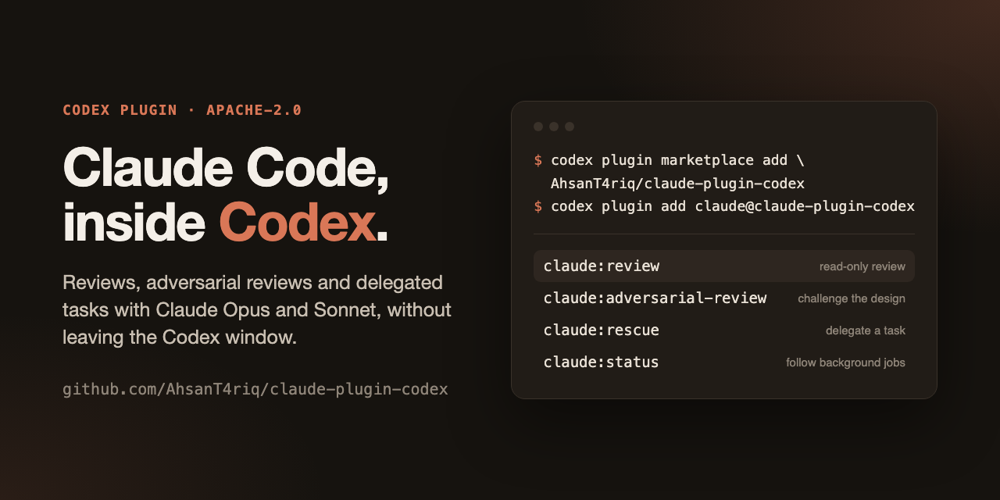

# Claude Code plugin for Codex

[](https://github.com/AhsanT4riq/claude-plugin-codex/actions/workflows/ci.yml)
[](LICENSE)



Use Claude Code from inside OpenAI Codex for code reviews or to delegate tasks to Claude Opus or Sonnet, without leaving the Codex window.

This plugin is for Codex users who want an easy way to bring Claude Code into the workflow they already have. Codex writes the brief with the context Claude needs, runs your local Claude Code CLI, follows the job and checks the result. It is the reverse of [openai/codex-plugin-cc](https://github.com/openai/codex-plugin-cc) and is not affiliated with OpenAI or Anthropic.

```bash
codex plugin marketplace add AhsanT4riq/claude-plugin-codex
codex plugin add claude@claude-plugin-codex
```

## What You Get

- `$claude-review` for a normal read-only Claude review
- `$claude-adversarial-review` for a steerable challenge review
- `$claude-rescue`, `$claude-status`, `$claude-result` and `$claude-cancel` to delegate work and manage background jobs
- `$claude-setup` to check that Claude Code is ready

## Requirements

- **Claude subscription or Anthropic API credentials.**
  - Usage counts toward your Claude Code usage limits, or is billed to your API account if you use an API key.
- **Claude Code CLI**, logged in. It must be recent enough to support the isolation flags the bridge launches with, such as `--safe-mode`. Older CLIs are refused before any work starts.
- **Node.js 20 or later.**
- **macOS or Linux** for background jobs.

## Install

Add the marketplace and install the plugin:

```bash
codex plugin marketplace add AhsanT4riq/claude-plugin-codex
codex plugin add claude@claude-plugin-codex
```

Start a new Codex chat. The skills appear in the `$` picker as `claude:setup`, `claude:review` and so on. Run:

```text
$claude-setup
```

`$claude-setup` tells you which `claude` executable it found, whether it is compatible and whether you are logged in. It never calls a model.

If Claude Code isn't installed yet:

```bash
npm install -g @anthropic-ai/claude-code
claude
```

Running `claude` once lets you log in.

A simple first run:

```text
$claude-review in the background
$claude-status
$claude-result
```

To update:

```bash
codex plugin marketplace upgrade claude-plugin-codex
codex plugin add claude@claude-plugin-codex
```

To remove the plugin, run `codex plugin remove claude@claude-plugin-codex`. Job history is kept in both cases.

### Install without the plugin system

On a Codex version without plugins, clone the repository and run `node scripts/install.mjs install`. This copies the bridge into your Codex home and links the seven skills into `~/.codex/skills`; `node scripts/install.mjs uninstall` removes only what it created. Don't use both install methods at once, or each skill appears twice.

## Usage

Invoke the skills from a Codex chat, in plain language. Codex writes the brief, runs Claude through the bridge, monitors it and evaluates the result.

### `$claude-review`

Runs a read-only Claude review of your current work.

Use it when you want:

- a review of your uncommitted changes
- a review of your branch compared to a base branch like `main`

Examples:

```text
$claude-review
$claude-review my branch against main
$claude-review in the background
```

The scope is chosen automatically: uncommitted changes if there are any, otherwise your branch against its base. You can also ask for working-tree or branch scope explicitly. Very large diffs fail instead of being silently truncated, so split them.

This skill is read-only and will not make changes. When it runs in the background, use [`$claude-status`](#claude-status) to follow progress and [`$claude-cancel`](#claude-cancel) to stop it.

### `$claude-adversarial-review`

Runs a **steerable** review that challenges the chosen implementation and design.

It uses the same scope selection as `$claude-review` and also takes focus text.

Use it when you want:

- a review before shipping that questions the direction, not just the details
- pressure-testing of tradeoffs, hidden assumptions and failure modes
- a focus on a specific risk area such as auth, data loss, race conditions or rollback

Examples:

```text
$claude-adversarial-review
$claude-adversarial-review against main, challenge the retry and caching design
$claude-adversarial-review in the background, look for race conditions
```

This skill is read-only. It does not fix code.

### `$claude-rescue`

Hands a task to Claude Code.

Use it when you want Claude to:

- investigate a bug
- plan or implement a change
- write or run tests
- continue a previous Claude task

Examples:

```text
$claude-rescue investigate why the tests started failing
$claude-rescue with edit access, fix the failing test with the smallest safe patch
$claude-rescue with Sonnet, low effort and shell access, run the test suite and fix what breaks
$claude-rescue in the background, investigate the regression
```

You can also just ask:

```text
Ask Claude to redesign the database connection to be more resilient.
```

**Notes:**

- **Access** is chosen for each turn: read-only (the default), edit (adds file edits) or shell (also adds commands). Ask for it explicitly; it is never inherited.
- **Model and effort:** the default model is `claude-opus-5-5` at medium effort. Name another model or effort to override them; a continuation keeps the previous turn's choices.
- **Continuing work:** follow-ups resume the exact Claude session of a recorded job. Only the newest job in a session can be continued; resuming an older one is refused rather than silently forked.
- **Timeouts:** 10 minutes by default, configurable up to 60.

> [!NOTE]
> Larger tasks can take a while. Running them in the background lets you keep working in Codex.

### `$claude-status`

Shows running and recent Claude jobs for the current repository, or the progress of one job.

Examples:

```text
$claude-status
$claude-status for job <uuid>
```

Use it to:

- check progress on background work
- find a job after reopening Codex, since background jobs keep running after the chat or app closes
- confirm whether a task is still running

### `$claude-result`

Shows the stored report for a finished job.

The report keeps separate:

- what Claude claimed
- what was actually observed: changed files, commands run and permission denials
- uncertainties

A job reported as completed is not proof that the task is correct, so Codex still verifies the work.

```text
$claude-result for job <uuid>
```

### `$claude-cancel`

Cancels an active job. Cancellation stops Claude but does not undo edits it already made.

```text
$claude-cancel job <uuid>
```

### `$claude-setup`

Checks that the selected Claude Code CLI is installed, compatible and logged in, and previews model, effort and access choices without calling a model.

## Typical Flows

### Review Before Shipping

```text
$claude-review
```

### Hand A Problem To Claude

```text
$claude-rescue with edit access, find out why the build fails in CI and fix it
```

### Plan, Then Implement

```text
$claude-rescue plan how to add rate limiting; no edits yet
$claude-rescue continue that job with edit access and implement the plan
```

### Start Something Long-Running

```text
$claude-adversarial-review in the background
$claude-rescue in the background, investigate the flaky test
```

Then check in with:

```text
$claude-status
$claude-result
```

## Claude Code Integration

The plugin runs your local `claude` CLI non-interactively. It looks for `CLAUDE_CODE_BINARY` first, then `claude` on your `PATH`. If an outdated CLI comes first on your `PATH`, point the plugin at the right one:

```bash
export CLAUDE_CODE_BINARY=/absolute/path/to/claude
```

Each run is deliberately isolated from your interactive Claude Code setup:

- your Claude Code customizations, plugins, skills and MCP servers are turned off for bridge runs
- tools are approved up front for the access you chose, and anything else is denied rather than prompting
- repository instruction files are not loaded automatically; Codex includes what Claude needs in the brief

Only one bridge job runs per Git workspace at a time. The bridge does not lock out other editors, including Codex itself, so avoid editing the same files concurrently. Worktrees count as separate workspaces.

The skills call a small CLI you can also use directly:

```bash
node bin/claude-companion.mjs setup
node bin/claude-companion.mjs rescue --cwd /path/to/repo --prompt-file brief.txt --access edit --background
node bin/claude-companion.mjs status --cwd /path/to/repo --job JOB_UUID --after 0 --wait
node bin/claude-companion.mjs result --cwd /path/to/repo --job JOB_UUID
```

Output is compact JSON; add `--full` for diagnostics.

## Limits

- **Not an OS sandbox.** Shell access can run any command your user can. Review preflight runs Git on your machine, so Git filters defined by the repository can execute. Only delegate on repositories you trust.
- **No undo.** Cancellations and timeouts stop the work but do not revert edits.
- **Background processes.** Processes Claude leaves running in the background are stopped when the job ends. A process whose launcher exits within half a second can slip past this check. If a survivor can't be stopped, the workspace stays locked.
- **No wakeups.** Codex isn't notified when a background job finishes; ask `$claude-status`.

## FAQ

### Do I need a separate Claude account?

No. If you are already logged in to Claude Code on this machine, the plugin uses that login. Otherwise, run `claude` once and sign in with your Claude subscription or an API key.

### Will it use my Claude Code settings?

Mostly not, by design. Bridge runs disable your customizations, plugins, skills and MCP servers so that delegated work is predictable. Organization-managed settings still apply, as does your login.

### Does it change what Claude is allowed to do on my machine?

Only within the access you choose for each turn. Read-only allows reading and searching, edit adds file edits, and shell adds commands. Requests beyond that are denied, never escalated.

## Development

```bash
npm test
npm run check
npm run release:check   # reproducible archive under artifacts/
```

## License

[Apache-2.0](LICENSE). Copyright 2026 Ahsan Tariq.
